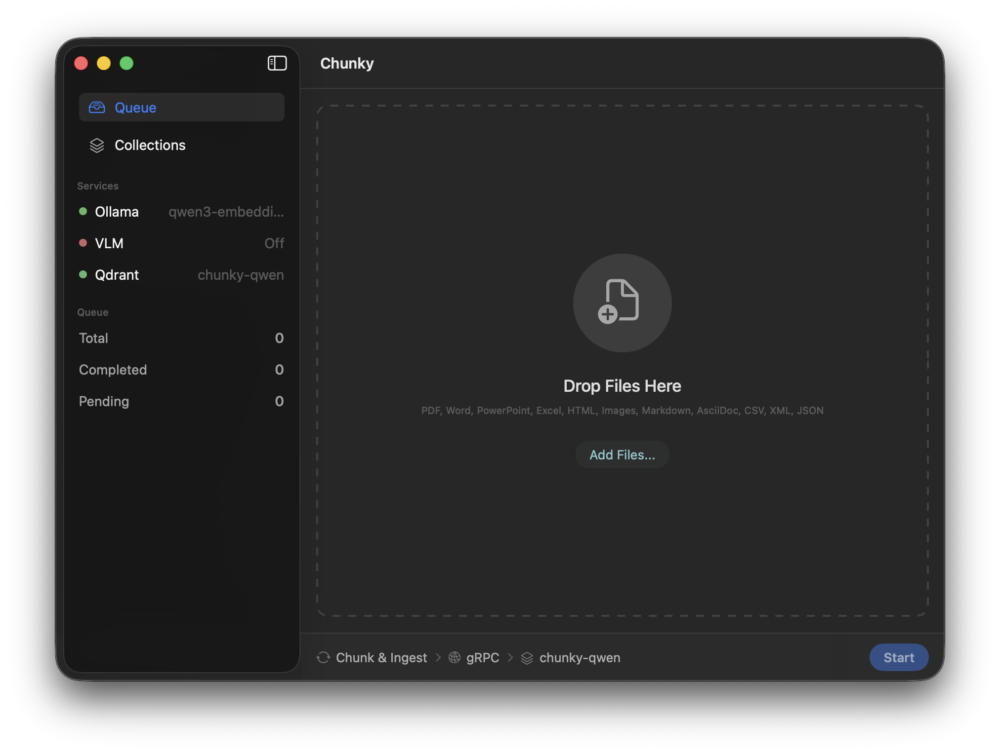

# Chunky

A native macOS application for processing documents into semantic chunks and storing them as vector embeddings in a Qdrant vector database.



## Features

- Multi-format document processing (PDF, DOCX, PPTX, HTML, images) via Docling
- Local VLM support with DocTags output (SmolDocling MLX, Granite-Docling MLX), or granite-docling on a worker host through vLLM
- Text chunking with configurable token limits and overlap
- Embeddings from Ollama or an OpenAI-compatible `/v1/embeddings` endpoint
- Vector storage in local Docker Qdrant or Qdrant Cloud
- Named worker profiles (wired LAN, Wi-Fi, Tailscale) with a reachability and latency check
- Retrieval over dense search or hybrid dense plus BM25 with RRF, plus an optional reranker
- Filters by year, author, DOI, title, heading, and element type
- Document summaries with an optional papers-first search, and expansion back to the parent section
- Named paper libraries stored as a Qdrant tenant field, with search limited to the active library
- Qdrant snapshot create, download, and restore from Collections
- Eval sets with recall@k, MRR, nDCG, and hit rate
- RAG chat with numbered citations, using pi or an OpenAI-compatible chat API
- Typst citations for APA 7 as adapted by the IU Zitierleitfaden: Hayagriva `.yml`, BibLaTeX `.bib`, and `#cite(<key>, supplement: [S. 12])`. See [docs/typst-citations.md](docs/typst-citations.md)
- A stdio MCP server (`search`, `list_collections`) for pi and other clients
- Analytics, a fixed-PDF benchmark, a collection browser, and export to Markdown, HTML, JSON, and plain text

## Prerequisites

- Xcode 27.2, macOS 27, Swift 6.4
- Docker (for local Qdrant v1.20.1)
- [Ollama](https://ollama.com/)
- Python 3.12 (Docling scripts and the worker)

The macOS 27.0 deployment target is intentional: the app, its test bundles, and the vendored `qdrant-swift` package share that baseline, tested with Xcode 27.2 in CI. Availability annotations for older macOS releases in individual types do not lower the app’s supported OS. Supporting an older release requires changing and validating both the app and the package targets.

```
brew install protobuf swift-protobuf grpc-swift
```

## Setup

```
make first-launch
make setup-venv
```

The Python venv is created at `~/.chunky-venv`. Script packages are pinned in `requirements/macos-scripts.txt`. Worker packages are pinned in `worker/requirements.txt`; Docling on the worker is `worker/requirements-docling.txt`. To bump a pin, change the file, install into a fresh venv, and run the unit tests.

`pyrightconfig.json` looks for a venv named `.chunky-venv` in the repo root. `make setup-venv` creates `~/.chunky-venv`. Symlink them (`ln -s ~/.chunky-venv .chunky-venv`) or set pyright's `venvPath` to your home directory.

`Package.resolved` is committed for `LocalPackages/qdrant-swift`. It is no longer gitignored.

> **Note:** The build disables code signing by default, so no Apple Developer account is required.

## Usage

```
make run           # build and launch the app
make build         # build only
make test          # Swift scheme, including UI tests
make test-python   # Python helper tests (no Docling needed)
make test-worker   # worker unit tests
make test-all      # scheme, helper tests, worker tests, and Docling integration
make clean         # clean build artifacts
make open-xcode    # open in Xcode
```

Start the required services:

```
make qdrant        # Qdrant v1.20.1 on localhost:6333 / 6334, volume chunky-qdrant
make ollama        # start Ollama
make services      # start both
```

## VLM Models

Chunky supports local vision-language models for document processing via Docling's built-in model specs. These run directly on Apple Silicon using MLX — no Ollama needed for VLM inference.

| Model | Engine | Output | Speed* |
|-------|--------|--------|--------|
| SmolDocling 256M (MLX) | MLX | DocTags | ~6s/page |
| SmolDocling 256M (Transformers) | Transformers | DocTags | ~102s/page |
| Granite-Docling 258M (MLX) | MLX | DocTags | — |
| Granite-Docling 258M (Transformers) | Transformers | DocTags | — |

*Single-page times from the Docling vision-model table. They are not a measurement of your machine.

On the app machine the default VLM is Granite-Docling MLX. On a worker host the default is granite-docling through vLLM. Change it in Preferences, Documents, VLM Model. "Standard (no VLM)" uses the classic layout-analysis pipeline. MLX models are hidden when the processing host is a worker.

## Worker and retrieval

The default embedding tag is `qwen3-embedding:0.6b` (1024 dimensions). Ollama's untagged `qwen3-embedding` is the 8B model. Switching width means a new collection. See [docs/models.md](docs/models.md).

Preferences, Documents, Processing host **Devbox** sends the file to a worker and polls progress. Save a profile per path and press Use before a job. Check reachability reports unreachable, HTTP 401, App Transport Security, success, and latency. The token stays in the Keychain. See [worker host](docs/worker-host.md), [reaching a worker](docs/remote-workers.md), and [use cases](docs/worker-use-cases.md).

On a direct 10GbE link, bind the worker to the devbox’s private 10GbE address with `CHUNKY_WORKER_HOST`, restrict the firewall to the app machine, and keep model servers on loopback. A non-loopback worker bind requires a bearer token; configure that same token in the app’s worker profile. The [Compose guide](worker/deploy/README.md) provides pinned ROCm worker and Ollama services, optional vLLM and Qdrant profiles, a token secret file, and `CHUNKY_BIND_IP` to publish only the worker port on the chosen private interface. Host GPU drivers and model downloads still need operator setup.

The worker can also run Granite-Docling with Transformers on ROCm when vLLM is unavailable: set `CHUNKY_VLM_ENGINE=transformers`. This is separate from the app machine’s Granite-Docling MLX default; see [worker setup](docs/worker-host.md).

An optional [Local Mac fallback](docs/local-fallback.md) can run a job locally if the worker is unreachable before upload. It is off by default, requires compatible local services for ingest, and never retries a submitted job or redirects a Cloud collection.

The Retrieval tab searches the active collection and the active paper library. With Processing host Devbox and Devbox ingest set to Qdrant Cloud, that search is `POST /v1/search` on the worker profile that Use applied. Otherwise it searches the Qdrant URL on the app machine. Hybrid search fuses the dense vector with a Qdrant BM25 text query using RRF. Rerank is optional and runs on the app machine against a Cohere-style `/v1/rerank` URL. Filters narrow by year, author, DOI, title, heading, or element type. Papers first returns the stored document summary, then can open the chunks from those documents. Expand to section joins sibling chunks that share the heading path. A library is a name and a stable id on each point. Search stays in the active library unless you pick a set or all libraries. Points that have no library remain in the default library. Eval stores recall@k, MRR, nDCG, and hit rate for a JSON query set. Ask in that tab to answer from the hits with citations. Chat uses a local pi install (`npm install -g @earendil-works/pi-coding-agent`) or an OpenAI-compatible chat API. `Chunky --mcp` serves the same search to pi and other MCP clients. See [MCP](docs/mcp.md).

Collections can create a Qdrant snapshot, download it, and restore it onto the server the browser is using. Restoring asks before it overwrites that collection.

## Embedding and chunk caches

Preferences, Embeddings, Performance distinguishes two mechanisms:

- **Reuse embeddings in Qdrant** checks existing chunks in the target collection for the same source, library, and text/model hash, and embeds only changed chunks. With **Streaming Pipeline off**, Local Mac ingest uses this check. With streaming on (the default), fresh batches skip the Qdrant lookup; imports whose complete vectors are supplied by the chunk cache still use the sequential reuse path. The reuse control therefore stays available for Local Mac in either mode. Switching pipelines keeps the saved reuse preference. These local controls do not configure Devbox jobs.
- The separate **chunk cache** reuses Docling conversions when the file content, Docling version, pipeline, and chunker settings match. Stored vectors are reused only for a matching embedding model and dimension. This works independently of streaming and the Qdrant reuse toggle; streaming can therefore report a chunk/vector cache hit. Preferences, About, Chunk cache sets its storage limit and clears it. Reconvert bypasses this cache. Devbox jobs use the worker's chunk cache.

No collection is recreated or reconfigured by changing these controls.

## Architecture

```
Chunky/Sources/
  Models/         AppState, settings, jobs, retrieval eval
  Services/       Docling, Ollama, Qdrant, worker client, retrieval, pi, MCP
  Views/          Queue, Collections, Retrieval, Eval, Analytics, Benchmark, Preferences
  Theme/          AppTheme
worker/           FastAPI worker: jobs, ingest, dense and hybrid search
LocalPackages/    qdrant-swift (gRPC and REST client)
```

## Dependencies

- [grpc-swift-2](https://github.com/grpc/grpc-swift-2) -- GRPCCore
- [grpc-swift-nio-transport](https://github.com/grpc/grpc-swift-nio-transport.git) -- GRPCNIOTransportHTTP2
- [grpc-swift-protobuf](https://github.com/grpc/grpc-swift-protobuf.git) -- GRPCProtobuf
- [swift-protobuf](https://github.com/apple/swift-protobuf.git)
- [swift-collections](https://github.com/apple/swift-collections.git)

The gRPC migration already landed in [PER-55 / PR #5](https://github.com/hansdoebel/chunky/pull/5). The vendored `qdrant-swift/Package.swift` and its committed `Package.resolved` record:

| Package | Minimum in manifest | Committed resolution |
| --- | --- | --- |
| `grpc-swift-2` | 2.4.4 | 2.4.4 |
| `grpc-swift-nio-transport` | 2.0.0 | 2.12.0 |
| `grpc-swift-protobuf` | 2.0.0 | 2.5.0 |
| `swift-protobuf` | 1.41.0 | 1.41.0 |

These replace the old `grpc-swift` repository and 1.x transport/protobuf bounds. The major migration described as deferred in PER-57 is therefore already complete; no additional migration or downgrade is needed. SwiftPM’s `from:` requirements allow compatible updates within each major version. When updating the vendored package, validate its unit tests with `swift test --package-path LocalPackages/qdrant-swift --skip IntegrationTests` from the repository root, then build and test the macOS app. Live Qdrant integration tests remain a separate operator check outside CI.

## Resources

- [Model choices](docs/models.md)
- [Worker host](docs/worker-host.md)
- [Reaching a worker](docs/remote-workers.md)
- [Worker use cases](docs/worker-use-cases.md)
- [MCP search server](docs/mcp.md)
- [Worker API](worker/README.md)
- [Docling](https://www.docling.ai/)
