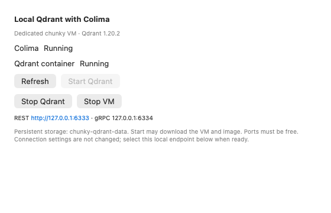
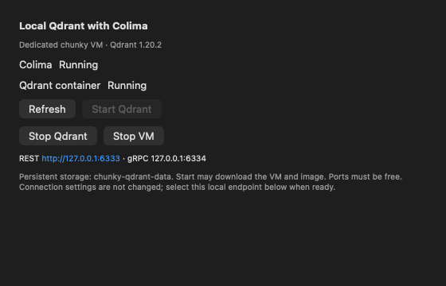

# Local Qdrant with Colima

Preferences → Qdrant includes a local runtime panel with separate Colima VM and Qdrant rows. Each service has its own action; **Start Qdrant** starts the VM too when needed. Green means running, red means stopped, and gray means unchecked, unknown or not yet created. A failed check shows an explanation and **Copy details**, without claiming that either service is stopped. **Check status** refreshes the observations. Install the tools yourself with `brew install colima docker`, then reopen Preferences. Chunky does not install Homebrew, Docker Desktop or Colima automatically.

**Start Qdrant** creates a dedicated Colima profile named `chunky` with two CPUs, 4 GiB memory and a 30 GiB disk, then starts `qdrant/qdrant:v1.20.2`. First start downloads a VM and container image and can take several minutes. The VM is separate from Colima's default profile. Subsequent starts retain the profile’s configured CPU, memory and disk sizes. Existing profiles named `chunky` are refused unless previously created by Chunky; rename or manage a pre-existing profile manually rather than deleting it.

**Configured CPUs**, **Configured memory**, and **Configured disk capacity** show values reported by Colima, not usage or assumed defaults. Missing values say “Not reported.” Creation defaults appear only after a check confirms that the profile does not exist. **Open configuration** opens the existing `~/.colima/chunky/colima.yaml` in its default editor. It is available only for an app-owned profile with a regular configuration file; symlink paths are refused, and the file is checked again when clicked. Chunky does not create or rewrite this file. See the official [Colima configuration](https://colima.run/docs/configuration/) and [profiles](https://colima.run/docs/profiles/) documentation.

The app uses the explicit local socket `~/.colima/chunky/docker.sock`. Docker context, host, TLS, Colima-home and Lima-home environment overrides are removed for these commands. Startup explicitly passes `--activate=false`, so Docker Desktop and other contexts retain their settings.

The app-owned container is `chunky-qdrant`; its named volume is `chunky-qdrant-data`, mounted at `/qdrant/storage`. Both are labeled `io.chunky.managed=qdrant-v1`. REST binds to `127.0.0.1:6333`, and gRPC binds to `127.0.0.1:6334`. Both ports must be free. The database is unauthenticated and reachable only through loopback port publishing; do not expose these ports to the network.

The panel never changes Chunky's saved Qdrant URL, API key, worker profiles, model identity or collection configuration. To use this database, explicitly select its local endpoint in the existing Qdrant connection controls. If you are using the worker, choose the existing Local Docker ingest path so the Mac handles local Qdrant access; a remote worker cannot reach the Mac's loopback address.

**Stop Qdrant** asks for confirmation and stops only a validated app-owned container. **Stop VM** asks for confirmation and refuses when any other container is present in the dedicated profile. Both operations interrupt active requests; stored collections remain. Refresh reports runtime/container state, not readiness for a particular embedding model or collection. Use the existing Qdrant connection check after starting.

There are no delete, volume-prune, automatic image-upgrade or collection-migration actions. Containers with unexpected ownership, image, storage or network configuration are refused. A newer image is not silently substituted into existing storage. Back up collections and plan upgrades explicitly.

The ownership marker is `~/Library/Application Support/Chunky/colima-profile-v1`. Keep it with the profile. Removing the marker does not remove any data; it makes Chunky refuse to control the existing profile. Runtime failures show the bounded end of command output, so download progress does not hide the final error; known environment secrets and URL credentials are redacted. Cancel operation or closing the pane cancels the current command and prevents later startup steps; it does not roll back a VM or volume already created. A timed-out start may still be completing in Colima; refresh and inspect `colima list --json` before retrying.

## Validation

Resource/status and configuration-path regression tests cover missing allocations, unknown states, ownership and symlink rejection. No new screenshots were requested for this UI revision. Unit tests inject command responses; they never start a VM or connect to Docker. They cover environment isolation, exact socket and loopback arguments, ownership conflicts, unrelated-container protection and persistent storage configuration, cancellation and timeout cleanup of a real harmless child process. macOS CI captures the production controls in light and dark appearances with nonblank assertions. A real Colima VM startup must be smoke-tested on a Mac with installed tools; the Linux build environment cannot validate macOS virtualization.

Historical controls (before the current row layout) captured on macOS in [CI run 43994415763](https://github.com/hansdoebel/chunky/actions/runs/43994415763), artifact `14290091066`, source `81455f7`. Both themes passed nonblank assertions and visual inspection. The running status is an injected UI fixture, not evidence of a live VM.

