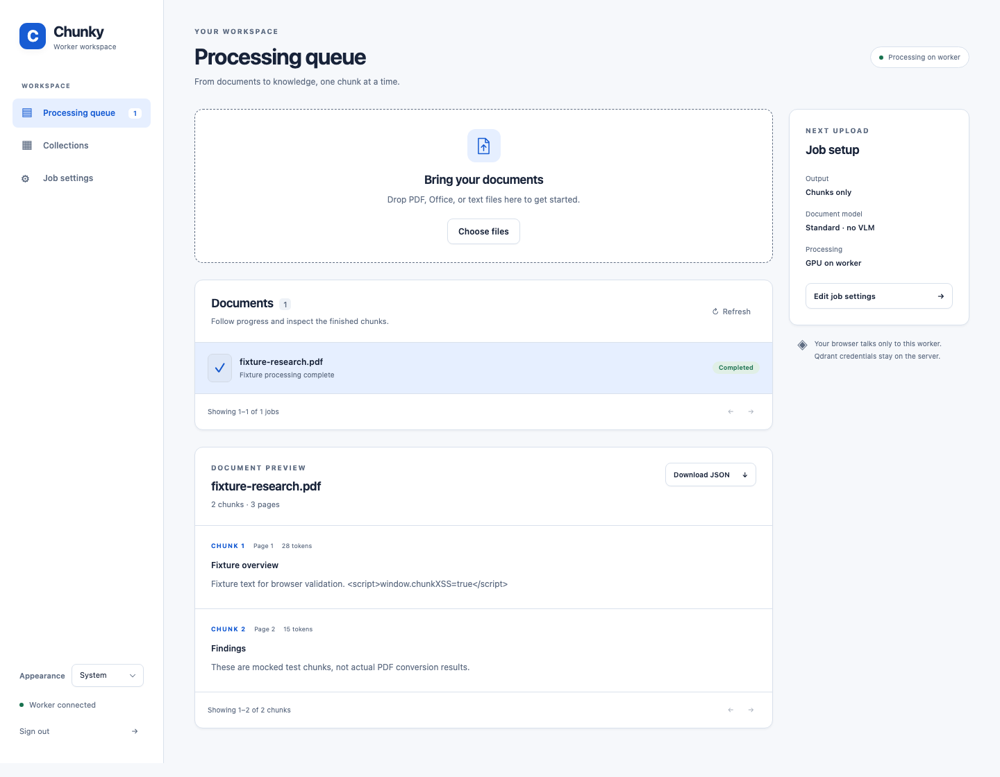
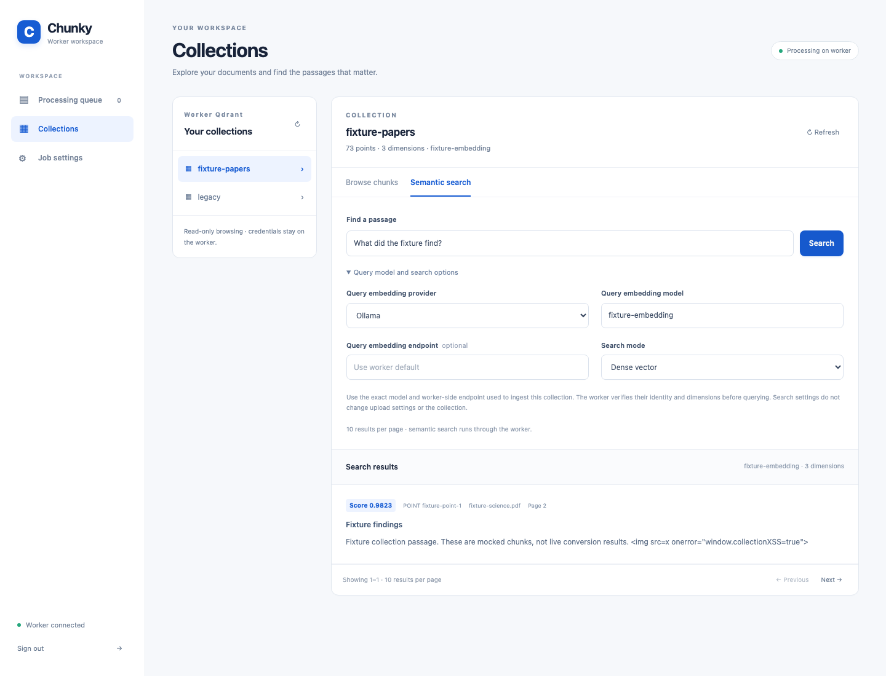
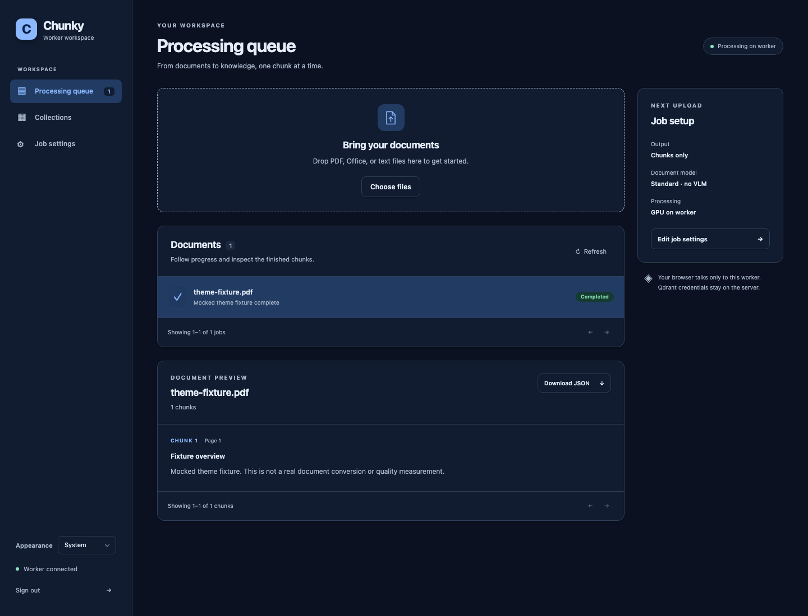
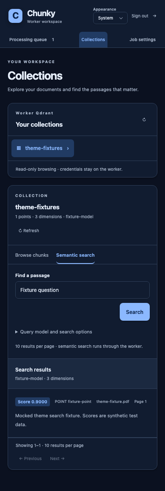
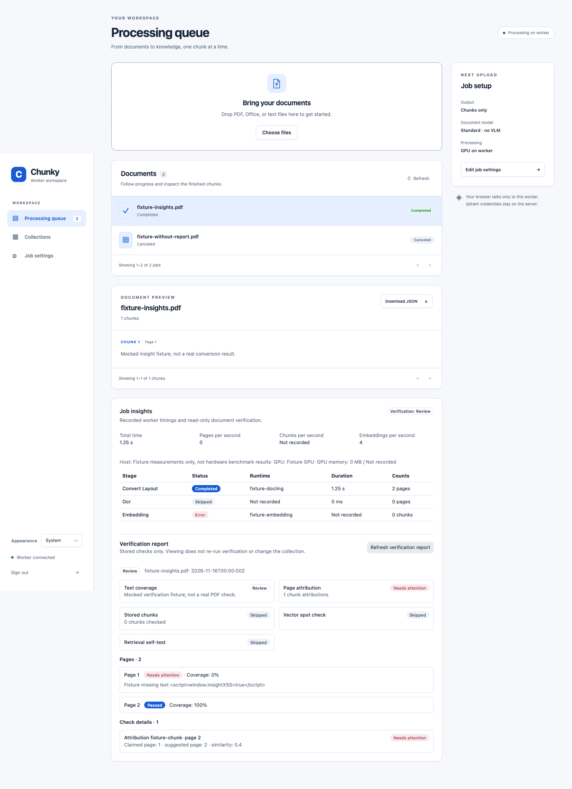
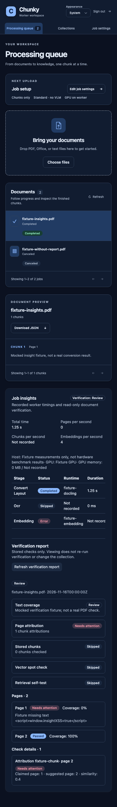
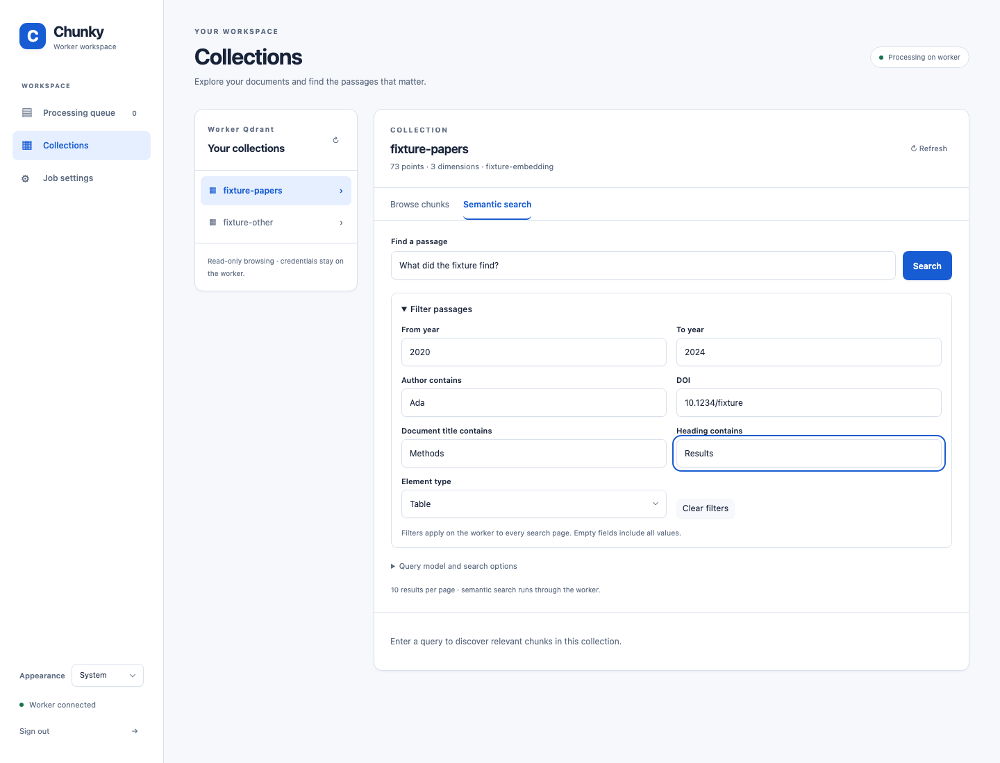
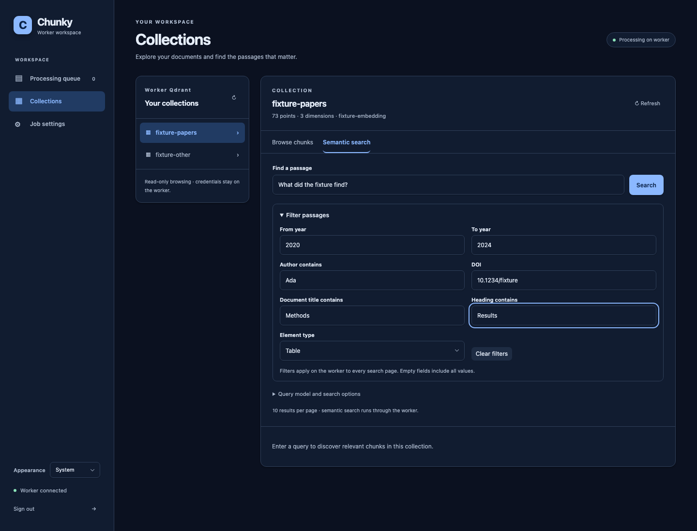
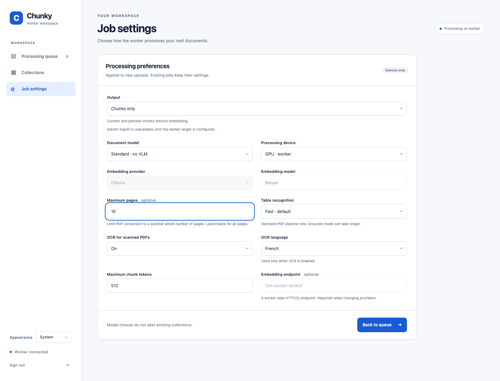
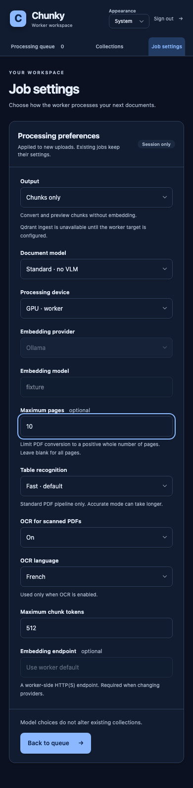

# Worker browser workspace

Open the worker URL in a browser to upload documents, follow queue progress, cancel work, preview chunks, and choose job settings. The workspace uses the same port and API as the macOS app. Evaluation, RAG chat, and reranking remain in the app.



Captured by the macOS browser unit tests with explicitly labeled fixture chunks; this image is not a live conversion result.

## Build and start

From the repository root, use Bun 1.4.4, Node.js 24.22.1 for compatible frontend tooling, and the committed `worker/web/bun.lock`:

```bash
make build-web
python3 -m venv worker/.venv
worker/.venv/bin/pip install -e 'worker[dev]'
worker/.venv/bin/chunky-worker --host 127.0.0.1 --port 8080
```

Install the worker's [Docling dependencies and model services](worker-host.md) before processing real documents. The frontend build writes `worker/chunky_worker/web_dist/`. Build before making a wheel or installing a non-editable worker package so it includes those assets. An API-only installation keeps its API available and returns a helpful HTTP 503 at `/` until assets are built.

The [Compose image](../worker/deploy/README.md) builds the frontend with pinned Bun and Node stages and copies only its generated assets into the worker image. Bun and Node are not needed in the running worker. No additional port is published.

For a remote worker, keep the existing token file, private bind address, firewall, and VPN or HTTPS setup. Use HTTPS or a trusted private tunnel for the browser session. Enter the worker bearer token on the login screen. The token stays in page memory; reload or sign out to clear it. It is never placed in URLs, cookies, browser storage, or generated assets. The login shell and static assets are public; job lists, results, settings, and events require the existing API authorization. Configure a token even on loopback to use the workspace. A loopback worker may start without one, but protected API routes still return HTTP 401.

## Appearance

Use Appearance on the login screen or in the workspace to choose System, Light or Dark. System follows operating-system changes. Only that nonsecret appearance preference is remembered in browser storage; bearer tokens, job settings, document data and credentials remain in memory. Blocked browser storage falls back safely to the current session and system appearance.

The UI uses shared shadcn-svelte components and theme tokens. Changing appearance does not contact model servers or change worker, provider or collection settings.

## Jobs and settings

Choose files or drop them into the upload area. Choose chunk-only processing, chunks with downloadable vectors, or ingestion into Worker Qdrant when the worker has a configured target. Model and job choices apply to new uploads. They do not change the macOS app's saved preferences or existing jobs.

Worker embedding backends are Ollama and OpenAI-compatible embeddings. Choose the exact model identifier, and use an explicit worker-reachable endpoint when changing backend. The endpoint is resolved from the worker, not the browser. FastEmbed CPU models belong to Local Mac processing and are not offered as worker models. Worker VLM choices are Standard, Granite-Docling Transformers, and SmolDocling Transformers; CPU/GPU availability still depends on the host.

Queue pages have an explicit size and navigation. Progress is streamed with the authorization header. Chunk previews show a bounded number of chunks with their page and headings; the full result can be downloaded explicitly. Preview requests omit vectors without deleting them from the job result. Treat downloads as document data. A failed upload response may still mean a job was accepted: refresh the queue before resubmitting. The browser does not automatically replay an uncertain upload.

Select a job to view its recorded total and stage timings, throughput, and worker resource measurements when available. Missing or partial measurements are labeled Not recorded; measured zeroes remain zero. Stages and verification pages and findings use explicit pagination, and long lists of page flags can be expanded.

The verification viewer reads the job's stored report without re-running checks or changing its collection. It shows recorded text coverage, page attribution, store, vector, and retrieval checks. Reports become available after processing finishes; missing reports and failed requests are shown explicitly. Viewing a report does not claim that an unrecorded check passed.

The queue is the worker's in-memory job store, shared with app/API submissions. Restarting the process clears that queue. This feature does not introduce durable job recovery or resumable uploads.

## Worker Qdrant credentials

Configure `CHUNKY_QDRANT_URL` and `CHUNKY_QDRANT_API_KEY` in the worker runtime environment to enable browser ingestion. The Compose worker forwards these optional variables. Inject the actual key through your deployment's private runtime configuration; do not commit it or put it into a frontend `VITE_*` variable. The configured URL must be HTTP(S) without embedded credentials, query parameters, or fragments.

The browser sends a collection name and `use_worker_qdrant=true`. It never receives or supplies the Qdrant URL/key. The server rejects target overrides for that mode, and refuses ingestion when the server target is incomplete. Worker ingestion currently requires an API key, including when the optional local Compose Qdrant profile is used. Keyless local Qdrant search through the existing API is a separate capability.

## Collection compatibility

For a new browser-managed collection, the worker records `chunky_embedding` metadata with the embedding backend, exact model identifier, a hash of the effective worker endpoint, dimensions, distance, and dense/hybrid layout. The raw endpoint is not stored in that identity. A model identifier assumes the operator keeps that model's contents stable; replacing weights under the same identifier requires a new collection.

An existing collection must have the same identity and actual vector layout, width, and distance. These checks run before document embedding and again before writes. A same-width model change is incompatible. Collections with unknown metadata, including legacy app-created collections, are refused for browser ingestion. Choose a new collection instead. The browser does not adopt, recreate, reconfigure, or overwrite an existing collection, and does not silently change its indexes or memory settings. Existing app/API ingestion without the browser-managed flag keeps its prior behavior.

## Validation

```bash
make test-worker
make test-web
```

Frontend checks cover Svelte/TypeScript, unit tests, a production build, and Playwright browser component tests with mocked worker responses. The macOS CI job captures the actual production frontend, rejects blank screenshots, and uploads the queue, chunks, settings, and mobile views. Fixtures are test data, not evidence of live PDF extraction. Worker tests use fake conversion, embedding, and Qdrant clients. CI also builds the frontend-only Docker stage with Bun; it does not start live model services, GPUs, Qdrant, or the ROCm runtime.

Live conversion, real model inference, and Qdrant integration are separate operator checks outside CI. The ROCm image and physical worker still require the deployment validation tracked in PER-53.

## Collections and semantic search



This macOS browser capture uses mocked collection passages and scores, not live conversion or retrieval-quality measurements.

Open Collections to browse the worker's configured Qdrant target. This is the server target from `CHUNKY_QDRANT_URL`; a Qdrant API key is optional for reads when that server permits keyless access. The browser never receives the target URL or key. Browse pages request 50 points without vectors and follow the server's continuation cursor. There is no client-side 1,000-point filter or implicit truncation.

Collections with unknown embedding identity remain available for read-only browsing. Semantic search requires trusted embedding metadata and matching actual collection configuration. Choose an indexed model/provider and, when the collection used a custom worker-side embedding endpoint, enter that same endpoint. Changing a query model, endpoint, collection, or search mode clears the previous hits. A same-width model substitution is refused.

Search uses the existing authenticated `/v1/search` engine with `use_worker_qdrant=true`. This pins Qdrant access to the configured server and validates model identity, endpoint fingerprint, dimensions, distance, and vector layout before querying. Dense search also works in a matching hybrid collection; hybrid search requires an existing hybrid layout. Browser reads and searches do not create indexes, adopt metadata, or change collection settings. Legacy app/API search retains its existing behavior.

Results show semantic scores, chunk text, source, and page metadata when present. Each search page requests 10 hits with an explicit offset and continuation; paging is a fresh query against the current collection, so concurrent writes can change rankings. This workspace does not promise a frozen search snapshot or modify stored points.

Expand Filter passages to narrow semantic results by year range, author, exact stored DOI, document title, heading, or element type (text, table, formula, figure, code). Text fields ignore surrounding whitespace; empty fields leave that attribute unrestricted. Years must be whole numbers from 1 to 9999, and the start year cannot exceed the end year. Invalid years show field errors and prevent the query from being sent.

Filters apply on the worker to every search page. Editing a filter clears previous hits and restarts paging; Clear filters restores an unrestricted search. Selecting another collection or signing out clears the filter draft. Filters are kept in page memory and do not change stored document metadata, embedding identity, or collection settings.
The light and dark captures below came from macOS browser CI run [43977623510](https://github.com/hansdoebel/chunky/actions/runs/43977623510), with nonblank PNG assertions. All displayed documents and scores are mocked test fixtures.





Job insight captures from macOS CI run [43978441720](https://github.com/hansdoebel/chunky/actions/runs/43978441720) use mocked timing and verification data, with nonblank image assertions. These are interface fixtures, not hardware measurements or document-quality results.




Filter captures from macOS CI run [43977736859](https://github.com/hansdoebel/chunky/actions/runs/43977736859) use mocked responses and nonblank image assertions.





Search for offers Passages, Papers, or Papers with supporting passages. Paper search requires stored document summaries. Paper paging advances by up to ten summaries; supporting passages are the top ten matches across those papers, not every chunk in every paper. Year, author, DOI and title filters apply to both searches. Heading and element-type filters are unavailable for paper search: retained values must be explicitly cleared before submission. Changing search kind clears stale results and resets paging. This view does not expand whole sections.

Job settings also offer optional Maximum pages for PDF conversion. Blank processes all pages; a limit must be a positive whole number. The Standard pipeline offers OCR (off by default), the worker default or English/French/German OCR language, and Fast/Accurate table recognition. OCR language applies only with OCR enabled. VLM uploads omit Standard OCR/table overrides; switching back retains the draft for this session. These settings apply to new uploads, remain in memory and reset on sign-out.

Processing controls captured by macOS browser CI [43984267460](https://github.com/hansdoebel/chunky/actions/runs/43984267460), with mocked responses and nonblank image assertions:




